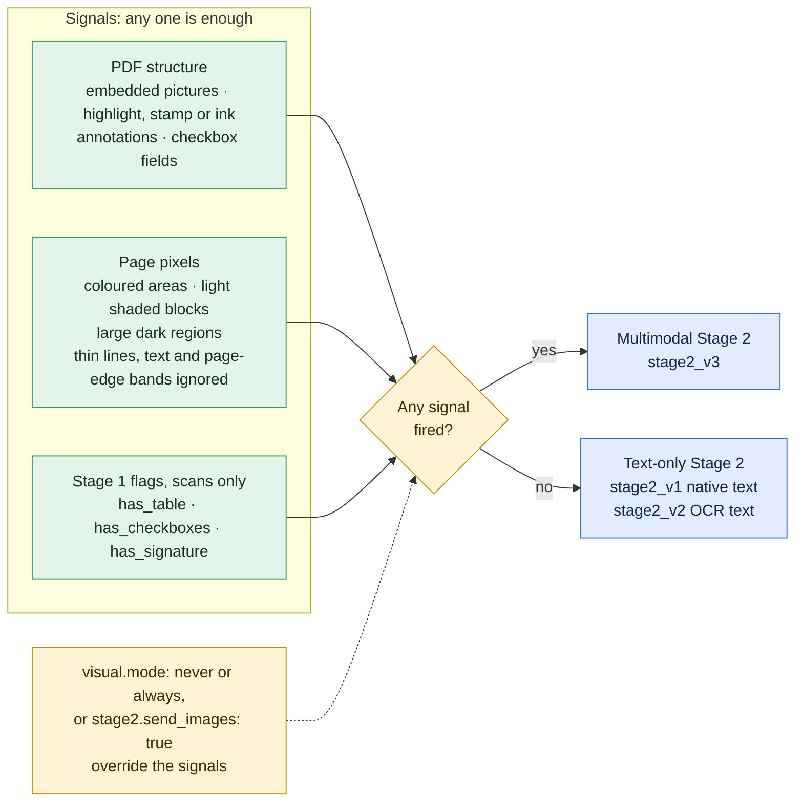
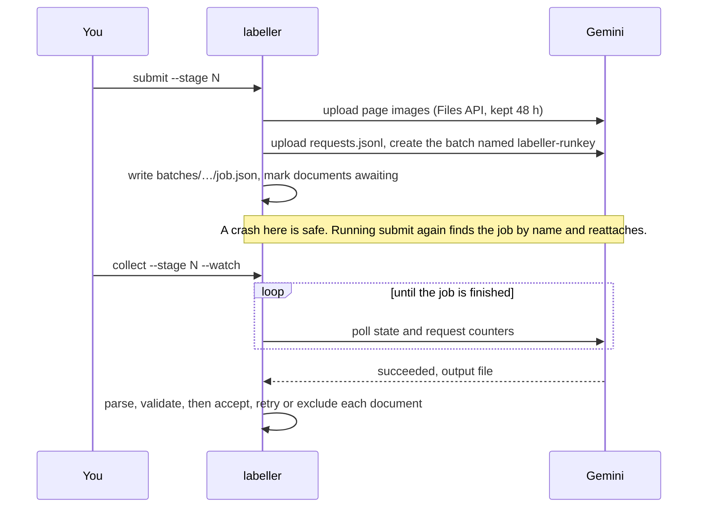
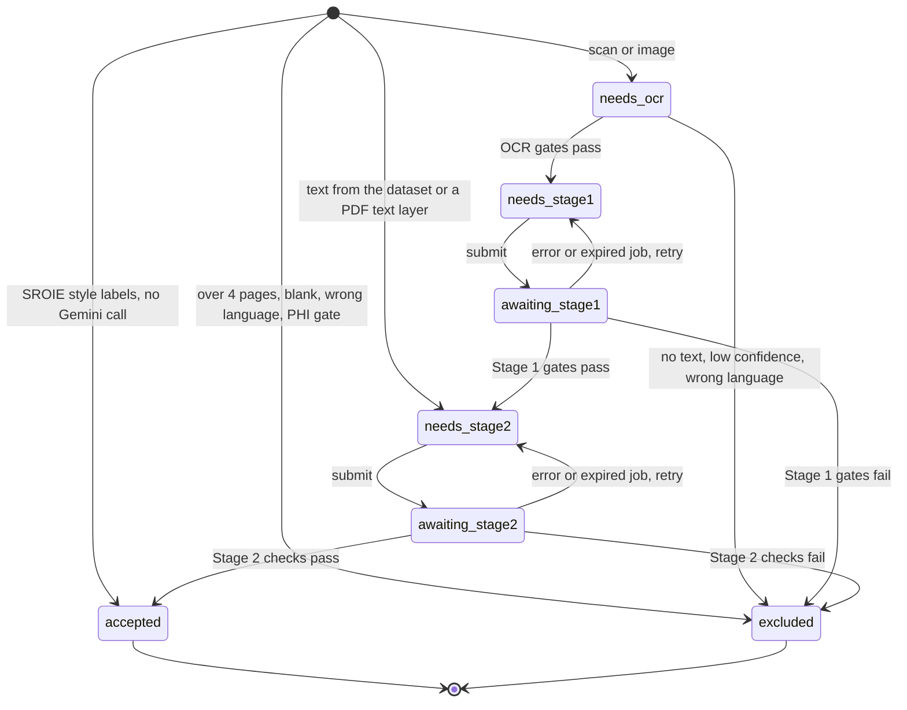

# Real-world Document Corpus Builder

A configurable ingestion utility for collecting **real source documents**, preserving source files, extracting document pages, categorizing samples, deduplicating exact files, and writing a provenance manifest.

It is intended as the acquisition stage before your teacher-model annotation / Batch API pipeline.

## Important distinction

This tool does not certify that a source is authentic, de-identified, or legally usable for model training. It records source claims and marks license review as `UNVERIFIED`. Review every dataset's current terms, consent, privacy conditions, and commercial-training rights before use.

Medical documents may contain protected health information (PHI). Do not ingest private clinical records unless you have the required authorization, agreements, safeguards, and compliant environment. The script does not perform de-identification.

## Layout

```text
parsedDoc/
├── config.yaml
├── pyproject.toml
├── requirements.txt
├── corpus/
│   ├── __init__.py
│   └── cli.py
└── data/                     # generated
    ├── raw/<source_id>/      # downloaded source archives
    ├── extracted/<source_id>/
    ├── pages/<source_id>/    # rendered PDF pages
    ├── manifest.jsonl
    └── summary.json
```

## Install

Python 3.10+ recommended.

```bash
python -m venv .venv
source .venv/bin/activate        # Windows: .venv\Scripts\activate
pip install -r requirements.txt
```

For Hugging Face sources:

```bash
pip install datasets huggingface_hub
```

## Usage

Preview enabled sources:

```bash
python -m corpus.cli --config config.yaml --dry-run
```

Download all enabled sources:

```bash
python -m corpus.cli --config config.yaml
```

Select one or more sources (also runs disabled sources when explicitly selected):

```bash
python -m corpus.cli --source funsd --source rxhandbd_zenodo
```

Override corpus size and document count:

```bash
python -m corpus.cli --max-total-gb 8 --max-documents 500
```

The global size budget includes files already present under `output_dir`. A source-specific `max_download_gb` limits downloaded bytes for that source. Rendered pages are also checked against the global budget.

## Sources configured

The total budget (`project.max_total_gb`, now 2.5 GB) is shared by the enabled sources. Each takes at most 300
documents and 0.25 GB, so the caps total 2.25 GB. Sources with fewer documents stop earlier.

| Source | Ingestion | Stage 1 | Visual (Stage 2 images) | Notes |
|---|---|---|---|---|
| NOVA invoices/receipts | `remote_zip` (Zenodo) | needed | never | Portuguese photos. The colour is the photo, not content |
| FUNSD | Direct ZIP | skipped | always | Own entity text. Checkboxes and handwriting are only visible in the image |
| DocLayNet reports | `remote_zip` (CDLA-Permissive) | skipped (text layer) | auto | Real reports with Picture, Table and Formula regions |
| XFUND French / German / Italian | `remote_zip` (GitHub releases) | skipped | always | Text from the release's annotation JSON |
| WildReceipt | Hugging Face streaming | skipped | never | Word text and boxes. Photos of receipts |
| Symage CMS-1500 | Hugging Face streaming, filtered on `form_id` | skipped | always | Synthetic claim forms, red printed form with checkboxes |
| ChartQA | Hugging Face streaming, grouped by image | needed | always | Real charts with question-answer pairs. **GPL-3.0**: kept `UNVERIFIED` |
| RxHandBD, OMR forms | various, disabled | | | Enable and check terms first |

`visual_mode` on a source sets whether its documents get the page images at Stage 2: `always`, `never`, or `auto`
(the local analysis decides). It overrides `visual.mode` for that source, so photo false positives never cost images.

**Already-labelled data skips Stage 1.** When a dataset ships its own text, the downloader saves it next to each image
as `<stem>.labels.json`, and the source uses `processor: sidecar_text` (`funsd` for FUNSD). Those documents skip OCR and
Stage 1 and go straight to Stage 2. A document with no annotation file, or an empty one, falls back to OCR, Stage 1 and
Stage 2.

**Grouped questions (ChartQA).** The dataset has one row per question, so `group_by_image: true` saves each distinct
chart once (de-duplicated by its bytes) and writes `<stem>.qa.json` with every question and answer about it. The cap
counts charts, not rows.

**Figures (Stage 2 v7).** Multimodal documents are labelled with `stage2_v7`, which adds a `figures` component: each
chart, diagram, photo or formula with its type, title, caption, one-sentence summary, axes, series of labelled points,
and trend. Points marked `estimated` were read off the axis rather than printed. The trend is recomputed from the points,
and a disagreement is corrected and marked `trend_corrected`. Charts with no data are rejected.

**Training tasks for these.** `figure` (the figures as JSON, schema in the prompt), `chart_qa` (ChartQA's own answers)
and `chart_trend` (trend, highest value and a labelled value, computed from the points that were read exactly; charts
with estimated points are skipped). Previously labelled documents keep their v1/v2/v6 annotations and have no figures
until Stage 2 is run again on them.

Progress shows as a live bar in a terminal. Where there is no terminal (a notebook `!` command, a pipe or a log file), it is written as timestamped log lines on **stderr** instead (every tenth of the work and at least every 5 s, with a `still working` line while one step is slow). Logging is never held back by buffering, so `python -u` and `PYTHONUNBUFFERED` are not needed. Command results (a plan, `status`, the summaries) stay on stdout. Every CLI takes `--log-level {DEBUG,INFO,WARNING,ERROR}` and `--log-file PATH`; for the labeller they go before the command: `labeller --log-file labeller.log run`. Capture both streams with `> run.log 2>&1`.

Downloads show progress: an overall `sources` bar, one bar per download (bytes for archives, documents for Hugging
Face and `remote_zip` sources, with the MB fetched), and a `catalogue` bar while files are hashed, classified and
rendered.

DocILE intentionally uses `manual`: its official repository requires a dataset access token and offers smaller subsets. Use the official downloader rather than bypassing access controls. See https://github.com/rossumai/docile.

### Taking a slice of a huge archive (`kind: remote_zip`)

Some datasets ship as one enormous ZIP. A `remote_zip` source reads only the archive's table of contents with HTTP
Range requests, picks a seeded random sample, and downloads just those members (plus optional sidecar files), so
a 8 GB archive costs a few megabytes. The server must answer Range requests with HTTP 206; otherwise the source
is refused with a clear error. Re-running resumes: files already present with the right size are kept.

```yaml
- id: doclaynet_pdfs
  kind: remote_zip
  url: "https://.../DocLayNet_extra.zip"
  include: ["PDF/*.pdf"]            # glob patterns for the documents to sample
  sidecars: ["JSON/{stem}.json"]    # optional files fetched next to each document when the archive has them
  max_documents: 200                # raise it to take more
  max_download_gb: 0.5              # cap on bytes actually fetched
```

`DocLayNet_extra.zip` holds 81,471 single-page, born-digital PDFs, so `max_documents` can go as high as the
disk budget allows. Each page has a text layer and goes straight to Stage 2 with no OCR.

## Slicing and size controls

In `config.yaml`:

- `max_total_gb`: total disk budget.
- `max_download_gb`: per-source download cap.
- `max_documents`: per-source document/sample cap.
- `max_pages_per_document`: PDF page rendering cap.
- `max_document_mb`: skip unusually large individual files.
- `pdf_dpi`: rendered page resolution.
- `sampling`: `first` or deterministic `random`.
- `max_files_per_source`: limit filesystem discovery.

Note: this implementation samples files after extraction. It does not yet download partial byte ranges from ZIP archives. For DocILE, use the upstream subset options to avoid downloading the entire collection.

## Categorization

The `category` on each source is a fallback. Filename/path keyword rules can override it. This is a weak initial categorizer, not a model prediction or ground-truth label.

For a robust corpus, keep three separate concepts:

1. `source_family`: where the data came from (FUNSD, DocILE, RxHandBD).
2. `document_type`: prescription, intake form, PO, fax, invoice, etc.
3. `visual_conditions`: scan, fax, handwritten, rotated, low-resolution, multi-page, stamped, etc.

The script currently writes the first two in a basic form. Add visual-condition labels after page analysis or teacher-assisted classification; don't infer them from a source name.

## Manifest

`manifest.jsonl` contains one row per document/image sample:

- stable ID derived from source ID and SHA-256
- source URL and declared license
- category and categorization method
- original file path, SHA-256, byte size and file type
- rendered page paths
- annotation status
- explicit unverified provenance/license states

For word-crop datasets, one image is one sample. For PDFs, one PDF is one document and rendered pages are attached to that document record.

## Recommended next stage

Consume `manifest.jsonl` in a separate annotation worker. It should:
1. select documents by source/category/visual condition;
2. send page images to your teacher model;
3. store raw teacher responses separately from validated annotations;
4. record schema version, teacher model/version, prompt hash and request ID;
5. route low-confidence or inconsistent samples to human review.

Keep source assets immutable. Never overwrite originals with normalized or redacted copies.

## Labeller (Gemini Batch annotation)

`labeller/` turns the corpus manifest into validated, schema-driven annotations. Configuration is in
`config/annotation.yaml`; it needs `GEMINI_API_KEY` (read from `.env`) only for the steps that call Gemini.

```bash
uv run python -m labeller.cli plan          # route documents, estimate tokens (writes nothing)
uv run python -m labeller.cli run           # everything, with progress bars: prepare → OCR → Stage 1 → Stage 2 → export
uv run python -m labeller.cli status        # documents per state, top exclusion reasons
uv run python -m labeller.cli visual        # which documents would go multimodal, and why (free)
uv run python -m labeller.cli reevaluate    # re-run the gates on saved Gemini output after changing a setting (free)
uv run python -m labeller.cli export --include-unverified   # train/val/test; unverified licences go to export/unverified/
```

The steps also run one at a time: `prepare`, `ocr`, `submit --stage 1|2 [--limit N]`, `collect --stage 1|2 [--watch]`,
`export`. Every step is resumable: state lives in `data/annotations/<doc>/status.json` and each batch in
`data/batches/`, so a crashed run continues where it stopped and never submits a batch twice.

### System overview

Green steps run on this machine and are free. Blue steps call the Gemini Batch API and cost money. Every red
exit is recorded with its reason, never dropped silently.

```mermaid
flowchart TD
    classDef local fill:#e3f4ea,stroke:#2f9e62,color:#14301f
    classDef paid fill:#e2ecfc,stroke:#2f6fdb,color:#10264d
    classDef stop fill:#fbe4e4,stroke:#d64545,color:#4a1414
    classDef store fill:#f1f1f1,stroke:#777777,color:#222222

    subgraph COLLECT["1 · Collect: corpus-builder"]
        direction TB
        A["Sources<br/>Zenodo · Hugging Face · remote ZIP, partial range download · URLs"]:::local
        B["Download, safe extract,<br/>skip junk files, dedupe by SHA-256"]:::local
        C{"Blank PDF form?<br/>fillable fields mostly empty"}:::local
        D["Render up to 4 pages<br/>write data/manifest.jsonl"]:::local
        A --> B --> C
        C -- no --> D
    end

    subgraph ROUTE["2 · Route: labeller prepare"]
        direction TB
        E{"Over 4 pages, file missing,<br/>or blank form fields?"}:::local
        G["Dataset processor<br/>FUNSD · SROIE · RxHandBD · generic"]:::local
        H["Check labels,<br/>language filter"]:::local
        I["PHI gate, language filter,<br/>visual analysis"]:::local
        J["PHI gate,<br/>visual analysis"]:::local
        E -- no --> G
        G -- "labels and text shipped<br/>with the dataset" --> H
        G -- "text from the dataset<br/>or a PDF text layer" --> I
        G -- "scan or image,<br/>no text yet" --> J
    end

    subgraph READ["3 · Read the pages: scans only"]
        direction TB
        O["Local OCR: RapidOCR PP-OCRv5 server<br/>one pass per page, cached"]:::local
        OG{"OCR gates<br/>no text · blank page<br/>confidence below 0.60"}:::local
        LG{"Language<br/>allowed?"}:::local
        S1["Stage 1: Gemini Batch<br/>page images + numbered OCR draft<br/>returns corrections, missed lines, flags"]:::paid
        S1G{"Stage 1 gates<br/>unusable · blank · unreadable · illegible<br/>over 30 percent of characters changed<br/>language code"}:::local
        O --> OG
        OG -- passes --> LG
        LG -- yes --> S1
        S1 --> S1G
    end

    subgraph LABEL["4 · Label: Stage 2"]
        direction TB
        TX["Text only<br/>prompt v1 or v2<br/>fields"]:::paid
        MM["Multimodal<br/>page images + text, prompt v3<br/>fields · tables · visual elements<br/>layout · relationships"]:::paid
        VAL{"Stage 2 checks<br/>values found in the source text<br/>no uncertain or low-confidence fields<br/>not mostly empty<br/>ids, links and evidence consistent"}:::local
        TX --> VAL
        MM --> VAL
    end

    RJ[("data/rejected.jsonl")]:::stop
    T["Corrected text with line ids<br/>plus Stage 1 layout flags"]:::local
    V{"Visual content?<br/>auto mode"}:::local
    BX["Attach OCR boxes to cited lines"]:::local
    ACC[("annotation.json<br/>schema + values + provenance")]:::store
    X[("Excluded<br/>reason in status.json and excluded.jsonl")]:::stop
    EXP["Export: licence gate, split by document type<br/>train.jsonl · val.jsonl · test.jsonl"]:::local

    C -- yes --> RJ
    D --> E
    E -- yes --> X
    G -- "word crops" --> X
    H -- passes --> ACC
    H -- fails --> X
    J --> O
    OG -- fails --> X
    LG -- no --> X
    S1G -- fails --> X
    S1G -- passes --> T
    T --> V
    I --> V
    V -- no --> TX
    V -- yes --> MM
    VAL -- fails --> X
    VAL -- passes --> BX
    BX --> ACC
    ACC --> EXP
```



### How Stage 2 chooses between text only and multimodal

Chosen per document by free local analysis (`visual.mode: auto`). Multimodal costs about three times the input and
output tokens of text only on a test page, so only documents with visual content pay for it.



Use `labeller visual` to see every document's signals and route, and `labeller visual --apply` to save a changed
threshold for documents that have not reached Stage 2. Thresholds are shares of the page area and are set from
real scans; check them against your own documents.

### How a Gemini batch runs and resumes



### Document states



A document that keeps failing is excluded after `max_attempts` retries. `labeller reevaluate` re-runs the gates on
saved Gemini output and can move documents between `excluded`, `needs_stage2` and `accepted` without any new calls.

### What is saved where

```text
data/
├── manifest.jsonl            one row per collected document (corpus-builder)
├── rejected.jsonl            blank PDF forms rejected at collection, with the reason
├── annotations/<doc>/
│   ├── status.json           state, exclusion reason, language, visual routing, models used, batch jobs
│   ├── ocr.json              OCR lines with ids, confidence and boxes
│   ├── stage1.json           Gemini's corrections and layout flags
│   ├── source_text.json      the corrected text Stage 2 reads, with line ids
│   ├── stage2.json           validated Stage 2 answer
│   └── annotation.json       the final result: schema, values, language, visual routing, provenance
│                             (multimodal documents also: tables, visual_elements, layout, relationships)
├── batches/stageN-<runkey>/  input.jsonl, job.json, output.jsonl (raw Gemini output, kept for free re-checks)
└── export/                   train/val/test.jsonl, excluded.jsonl, summary.json (unverified/ until licences are checked)
```

### Blank forms and local OCR

- `corpus-builder` rejects blank PDF forms (fillable widgets mostly unfilled) before rendering. Rejections go to
  `data/rejected.jsonl` with the reason, so nothing is dropped silently. Thresholds: `project.min_widgets`,
  `project.max_fill_ratio`.
- The labeller applies the same rule to manifest rows, then a backstop after extraction: a document whose fields are
  mostly unfilled is excluded (`gates.min_extracted_ratio`).
- `labeller ocr` runs RapidOCR (PP-OCRv5 server models) on scanned pages, free and cached per document. Stage 1 (v2)
  then corrects the draft and reports layout flags instead of retyping pages. Set `ocr.enabled: false` and
  `stage1.prompt_version: stage1_v1` to go back to the vision-only path.
- First OCR run downloads about 170 MB of models into the RapidOCR package folder.

### Tuning the gates without paying again

Gemini's outputs are saved in `data/batches/`, so a gate change can be checked for free:

```bash
uv run python -m labeller.cli reevaluate
```

It re-runs both stages' gates on the saved outputs (no API calls). Documents that now pass Stage 1 wait in
`needs_stage2`; run `labeller run` to label them. Documents that no longer pass a tightened gate are excluded,
so the result always matches the current settings.

Gates in `config/annotation.yaml`:
- `max_change_ratio` (default 0.30): share of the OCR draft's characters Gemini really changed. Markup such as
  `[x]` or `[handwritten: ...]`, punctuation and case do not count.
- `max_value_gap` (default 6): an extracted value's words must appear in the source text in order, with at most
  this many other words between them. This tolerates values split across columns or by handwriting tags, and
  still rejects any value containing a word that is not in the source.

Both defaults are untuned. Check them against your hand-reviewed accuracy before trusting the exported set.

### Multimodal annotation (Stage 2 v3)

By default Stage 2 reads text only and produces `fields`. Set `stage2.send_images: true` in
`config/annotation.yaml` to also send the page images and use the `stage2_v3` prompt. The annotation then has
separate components, so each can train a different kind of model:

| Component | Content |
|---|---|
| `fields` | Extracted values, as before, plus `page` and `evidence` |
| `tables` | Headers, rows, cells with spans, and per-row visual properties (background, highlight, bold) |
| `visual_elements` | Checkboxes and their state, signatures, stamps, handwriting, highlights |
| `layout` | Titles, headers, footers, sections, columns |
| `relationships` | Links between the above by id (`checkbox_for`, `value_of`, `highlights`, ...) |

Spatial grounding comes from the OCR, not from Gemini. Components cite OCR line ids in `evidence`, and the
labeller attaches each line's measured box as `boxes` (pixels in `box_px`, 0-1 in `box`).
Text in fields and table cells must still appear in the transcription. Visual properties cannot be checked
by the labeller and are kept as Gemini reported them, so review them by hand.

### Language filter

The `language:` section in `config/annotation.yaml` lists the allowed languages (ISO 639-1 codes). Detection is
local and free, and runs before any Gemini call: on native text and PDF text layers when documents are routed,
and on the OCR text after `labeller ocr`. Stage 1's own `language` code is then checked against the same policy.

- `unknown_policy`: `reject` or `accept` for documents with too little text or low confidence.
- `mixed_language_policy`: `accept_if_primary_allowed`, `accept_if_all_allowed` or `reject_mixed`. A document counts
  as mixed when a second language holds at least 10% of its letters.
- Chinese, Japanese and other single-language scripts are decided by Unicode script. The statistical detector
  (`py3langid`) separates languages that share a script, and is restricted to a candidate list because
  unrestricted it labels noisy OCR English as other languages.
- The detected language is saved on each annotation as `language`. Remove the section to turn filtering off.

## Training (`train/`)

```bash
uv run --extra train python -m train.stats data/export/unverified --model-id deepseek-community/DeepSeek-OCR-2   # lengths first
uv run --extra train python -m train.train --config config/train.yaml                  # the whole run from one file
uv run --extra train python -m train.train --config train_qlora --epochs 3 --batch-tokens 4800   # a flag changes one thing
```

**Which checkpoint.** Training uses transformers' own `DeepseekOcr2ForConditionalGeneration`, whose converted weights
are `deepseek-community/DeepSeek-OCR-2`. The original `deepseek-ai/DeepSeek-OCR-2` repo ships custom code and
does not load into the native class. The tokenizer is the same, so `train.stats` numbers do not change.
`train.processors.deepseek_v2_batch_adapter` maps the loader's batch to the model's arguments (`pixel_values`,
`pixel_values_local`, `num_local_patches`); its token counts and pixels match `DeepseekOcr2Processor`.

### Config files (`config/train*.yaml`)

A run is described by a YAML file instead of a long command. Precedence, lowest to highest: the built-in defaults,
the file (and the files it `extends`), then flags, so `--epochs 3` changes only that for one run. `--config`
takes a path or a name in `config/`.

| file | for |
|---|---|
| `config/train.yaml` | the default: LoRA, bf16, bucketed batches, every setting listed and commented |
| `config/train_probe.yaml` | the memory probe: 8 steps, one max-length sample per batch, logging every step |
| `config/train_lora_check.yaml` | the first LoRA test: 16 documents, many passes, the loss must fall clearly |
| `config/train_qlora.yaml` | 4-bit base weights with AdamW |
| `config/train_full.yaml` | no LoRA, sharded with FSDP2 (`torchrun --nproc_per_node 4 -m train.train --config train_full`) |

Sections are `model`, `lora` (`r`, `alpha`, `dropout`, `target_modules`), `data`, `batching`, `optimizer` (with the
`scheduler`: linear warmup, then cosine or linear decay), `training`,
`checkpoints` and `hub`; each key is the flag without its dashes. A variant starts with `extends: train.yaml` and
lists only what differs. A misspelt section or key is an error with a suggestion, and a boolean from a file can be
switched off with its `--no-...` flag (`--no-lora`, `--no-tensorboard`). Each run writes the settings it really used to
`<out_dir>/resolved_config.yaml` (the Hub token is never written, and is not read from a file: use `HF_TOKEN`).

### Batching and memory

Examples range from about 280 to 5,000 tokens, so random fixed-size batches are mostly padding (66% when padded
to `--max-length`, about 30% to the longest example in each batch). With `--batch-tokens N` every batch holds
similar-length examples and as many of them as fit `N` padded tokens (at most `--max-batch-size`, 16 by
default): short examples come in big batches, long ones in small batches, padding falls to a few percent, and
the peak memory is set by `N`, not by the longest batch that happens to be drawn. On the pilot export the
padding waste was 1-3% against 32% for random batches of 4.

- `--max-length` is the longest sample you allow, in tokens with the image included. Anything longer is never
  drawn (another task of the same document is tried first), and the count is logged. It must fit one batch:
  `--max-length` rounded up to `--pad-multiple` (64) has to be at most `--batch-tokens`. Without `--max-length`
  it defaults to `--batch-tokens`.
- Batches are planned again at the start of each epoch (the task and format of every example are redrawn), so the
  number of steps per epoch can differ by a few. Under DDP / FSDP2 every rank gets the same number of steps, and
  the batches of one step are of similar length.
- `--loss-weighting token` (the default with `--batch-tokens`) makes every target token count equally across a
  gradient-accumulation window and across ranks, so a batch of short answers does not outweigh a batch of long
  ones. `--loss-weighting batch` is the plain mean of the micro-batch losses (the default without bucketing).
- `--compile` stays off by default. Batch shapes vary, so it keeps recompiling, and the padding saved is worth
  far more than its gain.

**Finding `--batch-tokens` on a small GPU.** The log line carries `peak_mem_gb`, the mean `batch_size` and
`padded_tokens` of the last window. Run a few steps, read the peak, scale to your GPU and repeat:

```bash
uv run --extra train python -m train.train --config train_probe          # the same as the flags below
uv run --extra train python -m train.train --config train_probe --batch-tokens 6400    # then a larger budget
```

`3200` tokens is one maximum-length sample, so `peak_mem_gb` there is the memory of one sample plus the model.
If it fits, double `--batch-tokens` until it does not, then keep the largest value that fits.

### Two GPUs (DDP), for example Kaggle's 2 x T4

```bash
%%bash
cd /kaggle/working/parsedDoc
export PYTORCH_CUDA_ALLOC_CONF=expandable_segments:True
uv run --extra train torchrun --nproc_per_node 2 -m train.train --config config/train.yaml \
    --strategy ddp --precision fp16 --batch-tokens 3200 --grad-accum 4 --progress lines
```

- `--strategy ddp` puts a full copy of the model on each GPU, so **it doubles the throughput and does not lower the
  memory per GPU**: the `--batch-tokens` that fits one card is the same for two. `--batch-tokens`, `--max-batch-size`
  and `--grad-accum` are per GPU, so a step sees twice as many samples as on one card.
- Both processes must find the weights already downloaded: run once on a single GPU first, or the two downloads race.
- If the first step hangs, set `NCCL_P2P_DISABLE=1` (some T4 hosts without peer-to-peer links hang on it).
- Every rank runs the same number of steps (the batch plan drops the uneven tail), only rank 0 writes logs,
  checkpoints and Hub pushes, and the token-weighted loss is normalised over both ranks.

### Pushing checkpoints to the Hugging Face Hub

```bash
export HF_TOKEN=hf_...            # a token with write access
uv run --extra train python -m train.train --config train.yaml --hub-repo your-name/ocr-sft --hub-every-save
# or in the file:  hub: {repo: your-name/ocr-sft, private: true, every_save: true}
```

Uploads run in the background and a failed upload is a warning, not an error. Each push writes a folder:
`last/` at every periodic save (`--save-every`, with `--hub-every-save`) and `final/` plus `last/` at the end:

| file | content |
|---|---|
| `trainable.safetensors` | the trained weights (any strategy) |
| `adapter_model.safetensors`, `adapter_config.json` | with `--lora`: a PEFT adapter, `PeftModel.from_pretrained(base, "your-name/ocr-sft", subfolder="last")` |
| `training_state.pt` | weights, optimizer, scheduler and the position in the epoch, for resuming |
| `run_config.json` | the command line and the step |

Resume on another machine with `--resume hf://your-name/ocr-sft/last/training_state.pt` (the same flags as before).
The training state holds the optimizer, so it is small with LoRA and many GB for full fine-tuning.
